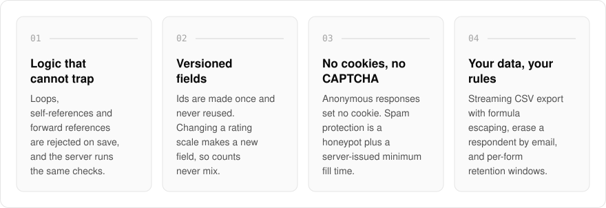
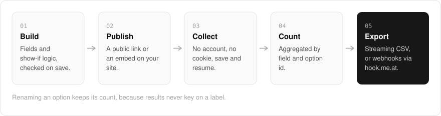

  <picture>
    <source media="(prefers-color-scheme: dark)" srcset=".github/assets/hero-dark.png">
    
  </picture>

<h1 align="center">poll.me.at</h1>

<strong>Change the questions without scrambling the answers.</strong>

  
  
  

  <a href="#features">Features</a> ·
  <a href="#how-it-works">How it works</a> ·
  <a href="#built-with">Built with</a>

Edit a live survey in most form builders and old answers quietly mix with new ones, or a renamed option splits its count in two. I built poll.me.at for forms and surveys with real conditional logic, where each answer stays tied to the exact question that was asked, even after you edit the form. Build a form, send it as a public link or embed it on your own site, then read the responses in a results console. Filling in someone else's form never needs an account.

  <picture>
    <source media="(prefers-color-scheme: dark)" srcset=".github/assets/overview-dark.svg">
    
  </picture>

## Why poll.me.at

| The usual form builder | poll.me.at |
| --- | --- |
| Editing a question mixes old and new answers | A changed field gets a new id, so versions never share a count |
| Renaming an option splits its results | Results count by option id, not label |
| Logic that can loop or strand a respondent | Loops and forward references are rejected on save, on the server too |
| Cookies and a CAPTCHA on every response | No cookie for anonymous responses; a honeypot and a minimum fill time instead |

## Features

- **Logic that cannot trap a respondent**: questions can depend on earlier answers, and loops, self-references and forward references are rejected on save, with the same checks run on the server for every save and publish.
- **Versioned fields**: ids are created once and never reused, and changing a rating scale creates a new field, so answers from different versions never land in the same count.
- **One link, no cookies, no CAPTCHA**: anonymous responses set no cookie. Spam protection is a honeypot field plus a server-issued minimum fill time.
- **Flexible collection**: optional one-question-at-a-time pacing, save and resume, and closing by hand, at a set time, or after a maximum number of responses.
- **Embeddable**: an iframe snippet with a small loader that resizes it, plus an allowlist of sites that may embed a form (anywhere else it shows read-only).
- **Counts that survive your edits**: results are aggregated by field and option id, not label, so renaming an option keeps its count.
- **Export and data control**: streaming CSV export with formula-injection escaping, erase a respondent by email, and per-form retention windows.
- **Sharing and webhooks**: share a form read-only with another account, and send response webhooks through hook.me.at.

## How it works

  <picture>
    <source media="(prefers-color-scheme: dark)" srcset=".github/assets/flow-dark.svg">
    
  </picture>

You build a form from fields and show-if rules, and every save and publish runs the same logic checks on the server that the builder runs in your browser. A published form collects on its public link or inside an embed, with no account and no cookie for the respondent. Responses are counted by field and option id rather than by label, so the results console stays correct through edits, and you can stream them out as CSV or forward them as webhooks.

## Built with

  
  
  
  
  
  

- Next.js 16 (App Router), React 19, TypeScript
- Tailwind CSS 4
- Drizzle ORM + Postgres
- Better Auth
- oRPC
- A separate embed SDK package for the widget loader

## Part of the me.at family

poll.me.at is one of my [`*.me.at`](https://me.at) apps. They share one design system, account, and app shell. Development happens in a private monorepo; this repository is the project's public-facing home.

## License

Source-available. See [LICENSE](LICENSE).
