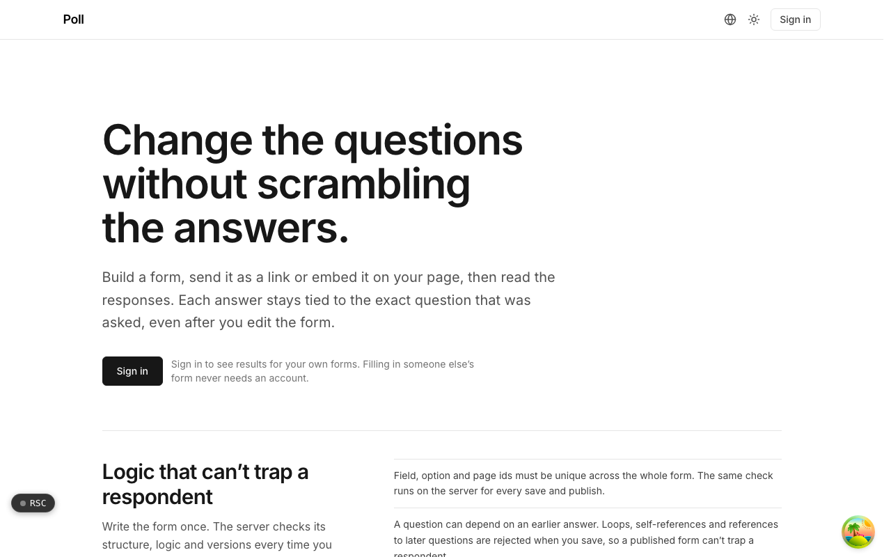

  <picture>
    <source media="(prefers-color-scheme: dark)" srcset=".github/assets/hero-dark.png">
    
  </picture>

# poll.me.at

Change the questions without scrambling the answers.

poll.me.at is forms and surveys with real conditional logic. Build a form, send it as a public link or embed it on your own site, then read the responses in a results console. Each answer stays tied to the exact question that was asked, even after you edit the form, and filling in someone else's form never needs an account.

## Features

- **Logic that cannot trap a respondent**: questions can depend on earlier answers, and loops, self-references and forward references are rejected on save, with the same checks run on the server for every save and publish.
- **Versioned fields**: ids are created once and never reused, and changing a rating scale creates a new field, so answers from different versions never land in the same count.
- **One link, no cookies, no CAPTCHA**: anonymous responses set no cookie; spam protection is a honeypot field plus a server-issued minimum fill time.
- **Flexible collection**: optional one-question-at-a-time pacing, save and resume, and closing by hand, at a set time, or after a maximum number of responses.
- **Embeddable**: an iframe snippet with a small loader that resizes it, plus an allowlist of sites that may embed a form (anywhere else it shows read-only).
- **Counts that survive your edits**: results are aggregated by field and option id, not label, so renaming an option keeps its count.
- **Export and data control**: streaming CSV export with formula-injection escaping, erase a respondent by email, and per-form retention windows.
- **Sharing and webhooks**: share a form read-only with another account, and send response webhooks through hook.me.at.

## Built with

- Next.js 16 (App Router), React 19, TypeScript
- Tailwind CSS 4
- Drizzle ORM + Postgres
- Better Auth
- oRPC
- A separate embed SDK package for the widget loader

## Part of the me.at family

poll.me.at is one of my [`*.me.at`](https://me.at) apps. They share one design system, account, and app shell. Development happens in a private monorepo; this repository is the project's public-facing home.

## License

See [LICENSE](LICENSE).
